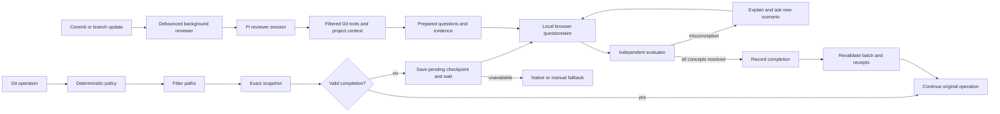

# Architecture

Sphinx has one local checkpoint engine and thin Git/agent integrations. It embeds `@earendil-works/pi-coding-agent` 1.2.0 for investigative reviewer sessions and requires Node.js 22.19+. Short-lived detached workers prepare reviews; there is no permanent daemon or Sphinx backend service.

## Checkpoint sequence

1. Git supplies the exact source and destination commits. Sphinx applies branch/event policy and filters paths before reading contents.
2. If the exact change already passed, the operation continues. Otherwise the hook saves a pending checkpoint and keeps the original Git process waiting.
3. The hook serves a private questionnaire on loopback and prints its URL. Git's stdin and the coding agent's shell are never used for questionnaire input.
4. Sphinx reuses matching prepared questions, waits for an in-progress review, or starts a fresh reviewer. The reviewer reads relevant diffs and follows related source and tests before committing questions, private answer keys, and supporting evidence. A separate model request audits the questions against that evidence before display.
5. Correct answers clear concepts. An incorrect answer gets an explanation and replaces that concept's question with a different transfer scenario, which receives its own source audit without the human answer or grading conversation. Ambiguity or evaluator failure never creates a completion record.
6. Sphinx revalidates every original snapshot and completion record, then returns control to the same Git process without replaying its command. Completion is bound to the exact repository, commits/index, destination, ignore policy, project context, assessment policy, and expiry.

## Modules

| Module | Responsibility |
| --- | --- |
| `config.js` | Defaults, global/repository settings, canonical/legacy policy discovery, private JSON files, credentials |
| `repo-config.js` | Exclusive creation of repository policy and ignore files, preserving existing files |
| `ignore.js` | Sensitive-file exclusions and project/global patterns |
| `git.js` | Deterministic triggers, filtered object/index evidence, snapshot identities |
| `routing.js` | Line/file/path tiers, depth-dependent question ceilings, and user-selected model routes |
| `model-presets.js` | Explicit economy presets, per-tier routes, billing descriptions, and reference sources |
| `evaluator.js` | Fresh CLI evaluator processes, question/rubric schemas, output validation |
| `reviewer.js` | Pi reviewer integration, exact observation archive, assessment validation, review budgets |
| `pi-runtime.js` | Isolated Pi SDK session, model-transport bridge, native compaction, cancellation, cleanup |
| `review-workspace.js` | Filtered immutable file, diff, listing, and search tools |
| `repo-context.js` | Bounded project background, ignore checks, context identity |
| `preparation.js` | Detached scheduling, debounce, exact cache matching, failure status |
| `openrouter.js` | Authenticated structured-output API requests and free-only price limits |
| `sessions.js` | Durable checkpoints, locks, progress, counted calls and optional caps, expiration |
| `deck.js` | Local retention deck of passed questions, spaced due dates, no model calls |
| `presentations.js` | Session-bound queues and hook-owned presentation markers, without code or answers |
| `git-gate.js` | Waiting Git gate, exact snapshot/receipt revalidation, batch ownership, and fallback |
| `browser-interview.js`, `browser-page.js` | Loopback human questionnaire, background browser opening, recovery, cancellation, and batch reuse |
| `change-view.js` | Read-only questionnaire display of the frozen checkpoint comparison: file list, per-file stats, diffs, and verified question evidence ranges |
| `git-interview.js` | Explicit separate-terminal transport retained for compatibility |
| `native-check.js` | Direct human-form assessment loop, queue claims, cancellation, and summary-only results |
| `mcp.js` | Bounded stdio JSON-RPC transport, form elicitation, and lifecycle tool responses |
| `install.js` | Reversible hook chaining, agent configuration, coverage checks |
| `agent.js` | SessionStart guidance and Claude shell-session tagging for native questionnaires |
| `pi-integration.js` | Pi extension installation, native dialogs, and deterministic queued-check presentation |
| `lifecycle-integrations.js`, `cursor-hook.js` | Cursor/OpenCode installation, browser handoff for queued fallback checks, and status-only client results |
| `terminal-launch.js`, `terminal-worker.js` | Explicit terminal transport, shared browser/native/terminal reservations, and private worker status |
| `activation.js`, `activation-worker.js` | Fresh coding-client sessions after installation, prompt-free launch, and startup acknowledgment |
| `cli.js` | Onboarding, terminal interview, public JSON protocol, hook entry points |
| `terminal.js`, `help.js`, `prompts.js` | Terminal presentation, contextual command help, and guided selections |

## Repository policy and terminal interaction

Machine-wide settings live in `$SPHINX_HOME/config.json`. A repository's canonical policy is JSON stored in `.sphinxconfig`. If that file is absent, the loader accepts legacy `.sphinx.json`. When both are present, canonical policy wins without merging the legacy file. Repository policy can control triggers, question depth, blocking mode, and exclusions; model routes, authentication, and usage budgets remain machine-wide. Repository exclusions add to machine-wide exclusions.

Reviewer presets write concrete per-tier routes into the global configuration. They are not dynamic model selectors: updating the preset catalog does not migrate saved models or trigger fallback. `sphinx config --preset <id>` and the `--small`, `--medium`, and `--large` flags edit those routes without reinstalling or invoking inference. Model-route changes remain part of assessment identity and invalidate reuse under the previous policy. The internal `openrouter/free` default remains for legacy configuration and checkpoint identity compatibility; new unattended installations require a preset or explicit route rather than accepting it silently.

`sphinx init` guides the user through event, branch, depth, mode, remote, and project-context choices. Branch defaults come from effective configuration rather than the currently checked-out branch. The initializer writes `.sphinxconfig`, `.sphinxignore`, and `.sphinxcontext.md` only when absent. It can copy a legacy policy into the canonical file while retaining the original. Rerunning setup preserves existing files and does not silently apply new flags over them.

Initialization does not install hooks, change global settings, resolve remote Git state, or invoke a model. Machine-wide integration is a separate, once-per-machine operation. A repository with a competing `core.hooksPath` needs the explicit `install --repo` compatibility step.

Human terminal output provides a compact ASCII mark, explanatory selections, and progress/context for assessments. Color and layout adapt to terminal capabilities. Every public command supports its own help through `sphinx <command> --help` and `sphinx help <command>`. `--json` output and hook protocols bypass decorative output; they remain suitable for coding agents, pipes, and tests. `NO_COLOR` disables color; redirected output is uncolored by default. Help and read-only status/configuration commands never invoke an evaluator. Reviewer dependencies are loaded only when an investigation starts, keeping ordinary Git gating and CLI inspection independent of reviewer initialization.

## Human questionnaire transports

A blocking Git hook saves pending assessments and hook-owned presentation requests, then serves a local browser questionnaire while the original Git process waits. On macOS, `open -g` opens the page in the background without activating or minimizing applications. Elsewhere Sphinx prints the local URL instead of guessing window-manager focus behavior. It never automatically opens Terminal for a questionnaire. The batch reuses one page for all destinations. Hook-owned requests are invisible to native after-tool callbacks, which cannot run until the original shell tool finishes. Browser, native, and terminal transports share a per-checkpoint reservation to prevent duplicate questionnaires.

Human answers go straight from the browser to the independent evaluator. Neither questions nor responses enter client hook results, and Git protocol stdin remains untouched. After completion, the gate reloads policy and revalidates every original snapshot and receipt, including previously approved destinations, before returning zero to the same Git process. Existing hooks run once before snapshot collection; commands, refspecs, force flags, stdin, and remotes are never reconstructed or replayed. Git retains its own remote-update concurrency checks.

The HTTP listener binds only to `127.0.0.1` on an ephemeral port and requires a random URL token. Responses are not cached; CSP prevents third-party assets, frames, and form navigation. POST requests require the exact host, origin, token header, current checkpoint/revision, and current question ID. The page renders all source/model text with `textContent`. Questions and feedback are public assessment fields; answer keys, rubrics, and retained source observations are never served. Provider calls stay in the hook process with its normalized Git context, preserving temporary indexes and explicit Git directories without exposing credentials or Git context in launch arguments. SSE carries current state; reconnects do not replay submissions, and monotonic updates prevent a delayed POST response from overwriting a newer question or completion.

Pause aborts active evaluation and releases the waiting operation without approval. Closing a browser tab does not pause the check: the URL can reconnect until the 25-minute deadline. Cancellation, stale content, missing receipts, and the deadline cause nonzero Git exit and cleanup of the hook-owned presentation batch. The per-operation server closes after the gate finishes. CI and evaluator subprocesses do not open pages or begin browser inference. An unavailable browser transport stops Git and queues the native/manual fallback. Codex and Claude Code lifecycle hooks call the local `sphinx_checkpoint` MCP tool only for this fallback queue. Its only arguments are repository context and host/session identifiers: `cwd`, `host`, `hookEvent`, and `hostSession`. It accepts no questions or human answers from the development model.

The controller claims queued work and uses MCP `elicitation/create` to present a flat form. The user can answer, learn, dispute, or pause. Responses return directly to Sphinx and its independent evaluator. Questions, feedback, and responses are not included in the tool result; the development model receives only allowlisted status, assessment IDs, progress, usage counts, and static retry guidance. The client controls how forms appear and may retain its own interaction logs.

The stdio server negotiates protocol `2025-11-25` or legacy `2025-06-18`, supports both modern `elicitation.form` and legacy empty elicitation capabilities, and correlates each form to an active tool request. Unsupported clients leave queued checks untouched and consume no inference. No queued work returns an empty hook response, including on clients without form support. JSON messages and accepted field values are bounded and validated; malformed answers, cancellation, disconnection, or timeouts cannot mark a check complete.

Advertised form support does not guarantee the client will display a request: client approval policies may cancel it. Codex 0.162.1's `never` policy does so unless its host enables full-access form input for a user thread. Sphinx preserves the pending assessment and does not alter the client's approval settings. Terminal checks remain available. Completion guidance retries only blocked Git operations.

A paused or dismissed presentation is consumed while its assessment remains pending. Unrelated shell commands therefore do not reopen it. A new Git attempt queues presentation again and resumes existing progress. Session identifiers let the integration find requests from commands that change directories or use `git -C`; Codex supplies its thread ID, and the Claude SessionStart hook appends a Sphinx session tag through `CLAUDE_ENV_FILE`. Outside native hosts, `sphinx check` provides the terminal interview using the same assessment state.

The browser questionnaire shows the change it is asking about. A sticky header names the repository, Git operation, destination, exact comparison, file and line totals, and progress, labeled as checkpoint changes rather than a whole pull request. Beside the question, a file list (all changed files or only those relevant to the question) and a unified diff are rendered from the checkpoint's recorded blob IDs: the push base and head, or the pinned index entries of a commit checkpoint. Later commits and working-tree edits cannot change them. Renames are detected for display only; the reviewer still uses `--no-renames`. Binary, symlink, submodule, mode-only, empty, non-UTF-8, and oversized files show an explicit state and never receive invented line counts. Long diffs are truncated with a visible count, and excluded files appear only as a count. Question evidence lists the paths the question cites. Line ranges appear only when a retained reviewer observation (read_file, read_diff page, or search match) matches the checkpoint's blob IDs and, for diff pages, its exact bytes at the recorded offset. Model-written evidence reasons are not shown because they can reveal the answer. Display updates never rotate the actionable revision, and browsing never touches the draft answer or the current question.

Pi's development-client integration is a separate local extension from the embedded reviewer runtime. It observes built-in `bash` and `powershell` results, then calls the same questionnaire controller for queued Git requests. `ctx.ui.select` presents Answer, Learn, Dispute, and Pause; `ctx.ui.input` collects the person's response. Only a fixed status message is appended to the shell result. Questions, feedback, and human answers never enter the coding transcript. Interactive or dialog-capable RPC mode is required; noninteractive modes preserve pending work for a terminal check. Pi's built-in shell session ID associates requests across `cd` and `git -C`.

Cursor and OpenCode adapters inspect queued fallback presentation metadata after shell tools and use the same local browser questionnaire. The client hook waits for a status-only result. This fallback cannot resume Git after it has exited; guidance permits a new invocation only after checking that the original operation failed at Sphinx, and forbids repeating waiting or successful operations. Questions, feedback, answer keys, human responses, and browser URLs never pass through the adapter's returned tool result. Cursor receives a context note; OpenCode receives a shell-result note and a TUI toast when available. Session environment tags support cross-directory routing. Cursor user hooks apply only to local sessions.

Private reservation records track the exact assessment, presentation token, and owning process. Active interviews are reused, and dead owners can be recovered. A paused presentation is consumed so unrelated tool events cannot reopen it; a new Git attempt can resume the assessment. Both direct Git and fallback browser interviews have bounded waits. Host shell or remote-connection timeouts may stop Git earlier; a late receipt never revives or replays an exited operation. `sphinx check --id <id>` remains an explicit terminal alternative using the same assessment and receipts. No browser or native transport grants completion by itself.

## Independent investigation and compaction

Version 2 snapshots contain change metadata and pinned Git identities, not a bundled patch. Before the first model request, Sphinx reads up to eight initial diff pages through the filtered immutable workspace, then a bounded file inventory when room remains, all within one quarter of `maxContextBytes`. These local reads consume no model calls. They enter the same exact evidence archive as subsequent tool observations, alongside statistics and `.sphinxcontext.md`. Listed names confer no citation privileges. Header-only or unavailable observations cannot satisfy the changed-code evidence requirement; if no usable evidence can be loaded within these limits, review stops before inference. The agent chooses `read_diff`, `read_file`, `list_files`, and `search` calls for missing ranges and dependencies. Tools filter paths before reading immutable blobs, reject unsafe paths and symlinks, and return bounded pages with explicit continuation information. Unchanged callers, tests, and dependencies are accessible at the pinned revision. Staged checkpoints retain index object identities.

The [Pi SDK](https://pi.dev/docs/latest/sdk) owns the reviewer session, agent/tool loop, and native compaction. Its entries and exact evidence archive are checkpointed privately so interruption does not discard the investigation. Sphinx registers only its filtered immutable workspace tools, supplies explicit project context, and disables ambient resource discovery and general-purpose tools. The session never loads the development transcript, project agent instructions, or unrelated Pi resources. `SPHINX_EVALUATOR=1` prevents recursive Sphinx hooks.

OpenRouter supplies model responses with native function calls. For explicitly selected `anthropic/` models, Sphinx sends `tool_choice: "auto"` on investigation and finalization requests to preserve compatibility with thinking-capable providers. Sphinx still rejects responses without actual tool calls and requires exactly one `finish_review` call during finalization; automatic selection never relaxes those local checks or triggers a transport retry. Other model families retain required or explicitly selected tool choices. See [Anthropic thinking and tool-choice compatibility](https://platform.claude.com/docs/en/build-with-claude/thinking#thinking-with-tool-use). The Codex/Claude compatibility routes use fresh isolated CLI invocations as model transports underneath Pi. Structured model responses become Pi tool requests; Pi schedules the registered Sphinx tools and carries the conversation into the next request. These routes reuse CLI authentication without copying secrets into prompts. They do not run a persistent Codex or Claude reviewer session, or delegate isolation to those clients' native tools.

Every request includes bounded project context (maximum 16,000 bytes). Context is descriptive data, not evaluator policy, and its claims must be checked against code. The current project file is hashed into checkpoint identity; an excluded context file is not opened.

Before Pi validates a `finish_review` call, Sphinx normalizes two lossless representation differences: a valid JSON-object string in `assessment` becomes an object, and `summary` or `evidenceIds` nested inside it moves to the envelope only when that outer field is absent. Questions, keys and citations are never rewritten by this step. Duplicate metadata, unknown properties and malformed JSON remain subject to strict rejection. The original native provider message and opaque continuation are retained separately from Pi's normalized arguments. Recorded response replays cover both native tool calls and structured CLI transports without spending another inference request.

The reviewer requests further diff pages, source ranges, file listings, and literal searches through Sphinx's tools. It can inspect unchanged callers, dependencies, and tests at the same pinned revision. File names are navigation hints; only inspected source can support a question. Sphinx enforces ignores and tool access locally and never grants an unrestricted shell or the developer's working files. Large patches are inspected incrementally rather than bundled into one prompt.

Pi session entries, the evidence archive, and an assessment awaiting its independent audit are saved privately under the checkpoint lock, so an interrupted review resumes without repeating the investigation. After compaction, the reviewer can recover archived observations with `read_evidence`.

Pi's [native compaction](https://pi.dev/docs/latest/compaction) summarizes older conversation history and rebuilds the active context. Sphinx separately archives exact observations with IDs, paths, revisions, and ranges under a fixed byte budget. Compaction can shorten Pi's transcript without changing this archive; a model summary cannot replace code evidence. Final questions must cite inspected paths backed by archived observations. Grading receives the question's selected original evidence, rubric, project context, and verbatim human answer.

New assessments separate their minimal acceptance criteria—one prediction and its causal reason—from the longer answer key and explanation. The independent audit checks both against source and aligns the visible question with the minimum criteria. A question that bundles extra checks must be narrowed, not given hidden requirements. Grading still rejects an unsupported key, but explanatory implementation details do not become additional requirements for the human. Older saved questions remain readable and are assessed against their visible behavioral question. All acceptance criteria and explanatory keys stay private.

Sphinx enforces `maxContextBytes` on serialized review context: prompts, tools, and schemas. Provider transport metadata is outside this count; it is not a byte limit on the complete HTTP body or the whole Git patch. Pi's estimated context threshold leaves reserve space for compaction, while tool pages and the evidence archive have separate bounds. Byte-based token estimates drive Pi's context management, particularly for CLI transports without reliable token reporting; these estimates are not billed usage totals. If the next review context cannot fit, the assessment remains incomplete. Every actual model request, including native compaction, is counted before invocation and checked against any explicitly configured checkpoint cap. Provider retries and cache warming are disabled; an error never triggers a paid-provider fallback. Correctable protocol and question-validation errors return feedback to Pi within the existing allowance. Exact citation evidence is resolved deterministically from observed paths; observation IDs are optional narrowing hints. A separate audit checks all proposed questions against retained evidence before display. Pending audits survive interruptions and resume without another investigation. Audited reviews use five/seven/eight requests as soft planning targets for small/medium/large changes. `agentMaxTurns` and `maxModelCalls` both default to `null`, so those targets never impose a hidden request cap. Explicit numeric `agentMaxTurns` values cap a review attempt; explicit total caps also reserve calls for grading. Correctable finalization and audit errors may continue within those explicit caps, context limits, and the investigation deadline. Provider failures still stop and require a human retry decision. Private audit feedback survives resume without appearing in public errors.

These adapters depend on recent CLI features. Unsupported flags or managed settings that conflict with isolation may cause a failure; Sphinx does not retry in a less isolated mode. Provider adapters need continued compatibility testing.

## Background preparation

Post-commit, post-merge, post-rewrite, and post-checkout dispatchers preserve original hook behavior, then schedule a detached worker without waiting for inference. A 1.5-second default debounce and job identities coalesce repeated work. Local push/upstream tracking metadata predicts the destination and remote base; missing tracking history is a cold-review case, not a reason to fetch or speculate automatically.

Workers call the same session preparation path as foreground checks. Exact source/destination/policy/ignore/context matches reuse questions and evidence. A foreground check waits for an in-progress review instead of duplicating requests. Superseded workers and changed snapshots cannot install valid prepared work. Preparation never opens a questionnaire or creates completion. Failures have safe status messages and require explicit retry. `backgroundPreparation: false` disables scheduling; repositories can opt out but cannot override a machine-wide opt-out.

## State and cost

The existing line, file-count, and consequential-path rules deterministically select a small, medium, or large tier before inference. A consequential path promotes even a tiny patch to large; file count alone does not establish simplicity. That tier selects the configured evaluator route and, together with question depth, the maximum initial question count:

| Tier | Relaxed | Standard | Thorough |
| --- | --- | --- | --- |
| Small | 1 | 1 | 1 |
| Medium | 2 | 2 | 3 |
| Large | 2 | 3 | 5 |

The evaluator may use fewer questions than the ceiling when fewer distinct behaviors are supported. Medium and large changes get at least one; a small change may get none when the audited review finds nothing a developer must understand, and documentation-only changes pass without a model call. The configured understanding distance sets whether questions address the change's behavior and effects (`high`), its specific implementation logic (`low`), or both across the assessment (`mixed`, the default; a single question takes whichever kind best tests the change). Checks prepared before `mixed` existed keep `high`. It must not invent extra concerns to fill the budget. Model routes remain independent of depth. `maxOutputTokens` is preserved across all tiers; OpenRouter enforces it, while CLI evaluators receive concise-output instructions and local process limits.

The economy CLI presets select `codex:gpt-6-luna` or `claude:haiku` for all tiers, preserving the cheaper model while effort and review planning targets scale. The paid OpenRouter value preset selects `anthropic/claude-haiku-5.5` for every tier and sets an 8,192-token output ceiling; an explicit output flag takes precedence. Applying the preset preserves the total call limit. The experimental open-weight alternative selects `deepseek/deepseek-v3.2`. Existing routes are never migrated implicitly. See [the evaluation record](../eval/RESULTS.md) for measured results and failures; these starting configurations are not guarantees of assessment quality. OpenRouter routes consume API credits separately from coding-agent plans; Codex and Claude routes consume the selected CLI account's allowance. Pi, Cursor, and OpenCode client integrations do not supply a model transport or reuse those clients' credentials.

OpenRouter request parameters require compatible provider endpoints; model-level capability lists can combine capabilities from different endpoints. The [Haiku endpoint API](https://openrouter.ai/api/v1/models/anthropic/claude-haiku-5.5/endpoints), checked October 15, 2026, lists native tools, structured output and automatic tool selection, but not required/named selection. Reference per-million input/output rates start at $0.10/$0.50 below 100,000 input tokens and $0.50/$2.50 at the higher context tier. These are reference rates, not price ceilings or a reliability evaluation. OpenRouter's default Auto Exacto routing considers tool-call quality; explicitly sorting by price disables that routing step. Sphinx still validates every response and does not turn missing tool calls or invalid output into completion.

Snapshot IDs include repository identity, exact objects/index, destination, effective policy, ignore-policy hash, and project-context hash. Ignored files affect immutable object identity but their contents never enter evidence. Before model calls, tool use, and completion, Sphinx revalidates local source/index and policies. The eventual Git hook compares a fresh destination snapshot to the completion record, so a changed remote base also invalidates reuse.

The policy identity also includes an assessment-contract version. The introduction of minimal acceptance criteria invalidates prepared assessments and receipts from the previous contract; Sphinx does not silently upgrade them or treat them as passing the new assessment. Changing only the call allowance still preserves a checkpoint's identity and usage within the current contract.

`pending → active → passed` is the main state sequence. Wrong answers teach the missed concept and replace its question with a new transfer scenario without advancing progress or adding another concept. Each proposed replacement receives a separate source audit before the grade reaches the session store. That audit sees exact retained evidence and the candidate, without the human answer or grading conversation. It can correct unsupported conditions or reject the replacement; rejection preserves the original pending question and incurred usage. A grade without a replacement costs one request; a proposed replacement costs two, subject to any explicit cap. Retries can exceed the initial question count. Without a configured cap, all calls remain counted but the total alone does not stop the check. Ambiguity remains active. Calls are counted before invocation, including failed attempts; explicit limits are enforced before invoking a provider. Per-session file locks prevent simultaneous grading and duplicate generation; expected question IDs reject stale responses. Cancellation during answer persistence rolls back progress while retaining incurred usage. Receipt readers acquire the same lock so they cannot observe a receipt being rolled back. Private state files use mode `0600`; public JSON and questionnaires deliberately omit private concept labels, rubrics, and full source evidence. Concept labels remain in private assessment state for grading and transfer-question matching because a generated label can reveal the answer.

The source audit can rewrite a provisional replacement that repeats the original question; strict novelty checks run on its final output. For an ambiguous answer, a source audit that cannot support a replacement preserves the feedback with no replacement, leaving the original question pending for clarification. An incorrect answer still requires a valid audited transfer. Provider, cancellation, format and context errors are not swallowed by this optional-replacement path. Neither path can turn ambiguity into approval.

Successful records expire after 24 hours by default. Passed questions are copied into a per-repository deck under `$SPHINX_HOME/decks` so they outlive that expiry. `sphinx drill` poses due cards locally: you answer, see the stored explanation from the original check, and mark again (1 day) or good (1, 3, 7, 14, then 30 days). JSON listings omit explanations. Passing a live check of the same prompt also counts as a successful review. Documentation-only passes add no cards. The deck is never sent to a model. Background investigation is enabled by default and shares the assessment's counted usage and any explicit total cap. Sphinx always bounds serialized review-context bytes, tool-page bytes, and whole-investigation time. With an explicit request cap, it reserves grading calls plus the final synthesis and independent audit. A lone remaining request cannot start a new synthesis that would lack its required audit. Near that explicit cap, native `tool_choice` requests `finish_review` while retaining earlier tool definitions for history compatibility, except for the Anthropic automatic-selection compatibility path above. The transport and reviewer reject any other returned call; the CLI response schema also allows only finalization, and Pi cannot compact away reserved requests. Missing evidence still fails the review. Only a saved pending audit can resume with one available review call; an unfinished investigation needs at least two, plus reserved grading calls when a total cap is set.

`maxModelCalls` is an optional operational ceiling, separate from assessment identity. Its canonical policy-hash value stays at the historical default of 10, and `agentMaxTurns` is normalized to its historical default of 8, preserving those existing checkpoint IDs when request caps change. Older checkpoints originally hashed with other custom limits require a fresh checkpoint. All other policy fields remain bound. Both defaults are `null`, meaning no request limit; numeric saved values remain explicit limits. The session store reloads global request limits under its lock before resume, grading, and every actual model request. A changed total cap replaces the absolute limit and records the change without resetting calls, questions, attempts, review evidence, or completion. Lowering below used calls blocks inference; clearing the cap preserves usage. Prior explicit retry extensions remain until the configured total cap changes. `sphinx config --max-model-calls <1-100|unlimited>` saves or clears the global total cap without reinstalling or invoking a model; `none` is an alias for `unlimited`. Public JSON represents an uncapped `usage.limit` as `null`, and human displays say “no limit.”

When a numeric total cap is configured, for a one-attempt extension without changing that global cap, `check --id <id> --retry-review` and the equivalent human choice in the interactive recovery menu remain available for failed, questionless checkpoints. Under its session lock, it validates the unchanged policy/snapshot, records prior attempt usage, and allows at most `maxModelCalls` additional requests. Total calls remain cumulative, and the public usage limit reflects the extension. Provider errors expose only numeric status and allowlisted error categories, never raw response messages or metadata. With no cap, or when enough calls remain for review plus grading, the interactive menu offers a retry within that allowance; otherwise it offers a new allowance under the explicit cap. Without a cap, a retry reuses saved work and never asks for an allowance extension. Pause is always the default, and every further failure requires a fresh choice. Known setup/auth/context failures and zero-request preflight failures do not offer another spending attempt; stale content or policy stops recovery. The browser page or explicit terminal stays open while the human decides, allowing the original Git hook to remain waiting within its deadline. JSON commands keep their noninteractive failure behavior. Ordinary resuming and background work adopt an explicitly edited global ceiling but never authorize an additional per-attempt allowance; active or passed questionnaires cannot be restarted. Provider escalation remains explicit. A local completion record is a workflow convenience, not a cryptographic attestation.

## Installation

A global Git `core.hooksPath` points to Sphinx dispatchers. Existing hooks are chained with their arguments and input preserved. Unrelated hook protocols are forwarded directly so interactive/streaming hooks are not buffered. Repository-level overrides need `sphinx install --repo` to wrap the repository's effective hook directory.

The installation manifest tracks original settings and the exact files/handlers Sphinx created. Uninstall restores only configuration it still owns; subsequent edits are preserved. `--agents auto` detects Codex, Claude, Pi, Cursor, and OpenCode from executables, configuration directories, or an existing installation record. An explicit comma-separated subset selects integrations; `none` selects Git-only setup.

Interactive setup begins with coding-agent checkboxes, with All supported agents first, then offers economy reviewer presets based on the selected clients. Users can choose paid OpenRouter, free OpenRouter as an explicit best-effort option, or custom per-tier routes. Existing configurations retain their saved routes unless the user selects a replacement. A deliberate paid selection in guided setup supplies consent; unattended `install --preset` and `config --preset` require `--allow-paid` or an existing paid-enabled setting. Fresh unattended installation without a preset or explicit reviewer route stops before installing. Credential setup remains separate, uses hidden input for OpenRouter keys, and makes no model request.

Codex and Claude integrations register a local stdio MCP server and inject guidance at session start. Codex uses a native `PostToolUse` MCP tool hook for `Bash`; Claude uses `PostToolUse` and `PostToolUseFailure` for `Bash`. Pi installs `extensions/sphinx.js` under `PI_CODING_AGENT_DIR` or `~/.pi/agent`; a new session or `/reload` loads it. Cursor adds `sessionStart`, `postToolUse`, and `postToolUseFailure` handlers to `~/.cursor/hooks.json`. OpenCode installs `plugins/sphinx.js` in its configuration directory, honoring `OPENCODE_CONFIG_DIR` or `XDG_CONFIG_HOME`, without rewriting `opencode.json` or JSONC settings.

After configuration succeeds, interactive `sphinx install` opens the selected installed clients by default. `--no-launch` defers activation; `install --yes` opens clients only with explicit `--launch`. `sphinx activate` opens already-configured integrations without reinstalling, and `--agents codex,claude,pi,cursor,opencode` can select a configured subset. `--json` returns launch outcomes without decorative output. Repository-only `install --repo` remains a hook-compatibility operation.

Activation starts fresh Codex, Claude Code, Pi, and OpenCode CLI sessions, or a new Cursor editor window. It supplies no initial model prompt, invokes no Sphinx evaluator, and does not restart existing processes. Missing executables or headless environments produce a focused manual-launch fallback. A successful launch means the client opened, not that its MCP connection, form support, or hook trust has been verified. Native client trust decisions remain with the human; Codex's hook browser must be opened with `/hooks`. Sphinx does not pass a slash command as an initial model prompt or use an undocumented approval deep link.

The Git hook remains the canonical local checkpoint. Client integrations consume already queued work; they do not let a model decide whether a check is required. Evaluator sessions tagged `SPHINX_EVALUATOR=1` skip queueing and client presentation. Tests redirect integration homes and never install into a developer's real configuration.

## References

- [Pi SDK](https://pi.dev/docs/latest/sdk)
- [Pi compaction](https://pi.dev/docs/latest/compaction)
- [Pi SDK full-control example](https://github.com/earendil-works/pi/blob/main/packages/coding-agent/examples/sdk/12-full-control.ts)
- [Pi extensions](https://pi.dev/docs/latest/extensions)
- [Cursor hooks](https://cursor.com/docs/hooks)
- [Cursor MCP support](https://cursor.com/docs/mcp)
- [OpenCode plugins](https://opencode.ai/docs/plugins/)
- [Git hook protocols](https://git-scm.com/docs/githooks)
- [Git central hooks path](https://git-scm.com/docs/git-config#Documentation/git-config.txt-corehooksPath)
- [Codex hooks and trust](https://learn.chatgpt.com/docs/hooks)
- [Codex CLI reference](https://learn.chatgpt.com/docs/cli/reference)
- [Claude Code hooks](https://code.claude.com/docs/en/hooks)
- [Claude Code CLI reference](https://code.claude.com/docs/en/cli-reference)
- [MCP form elicitation](https://modelcontextprotocol.io/specification/2025-11-25/client/elicitation)
- [MCP initialization and protocol negotiation](https://modelcontextprotocol.io/specification/2025-11-25/basic/lifecycle)
- [MCP stdio transport](https://modelcontextprotocol.io/specification/2025-11-25/basic/transports)
- [OpenRouter structured outputs](https://openrouter.ai/docs/guides/features/structured-outputs)
- [OpenRouter tool calling](https://openrouter.ai/docs/guides/features/tool-calling)
- [OpenRouter provider price limits](https://openrouter.ai/docs/guides/routing/provider-selection)
- [OpenRouter Auto Exacto routing](https://openrouter.ai/docs/guides/routing/auto-exacto)
- [Qwen3 Coder Next endpoints](https://openrouter.ai/api/v1/models/qwen/qwen3-coder-next/endpoints)
- [Qwen3 Coder endpoints](https://openrouter.ai/api/v1/models/qwen/qwen3-coder/endpoints)
- [DeepSeek V3.2 endpoints](https://openrouter.ai/api/v1/models/deepseek/deepseek-v3.2/endpoints)
- [Qwen3 Coder Next model card](https://huggingface.co/Qwen/Qwen3-Coder-Next)
- [Codex model configuration](https://learn.chatgpt.com/docs/models)
- [Claude model configuration](https://code.claude.com/docs/en/model-config)
