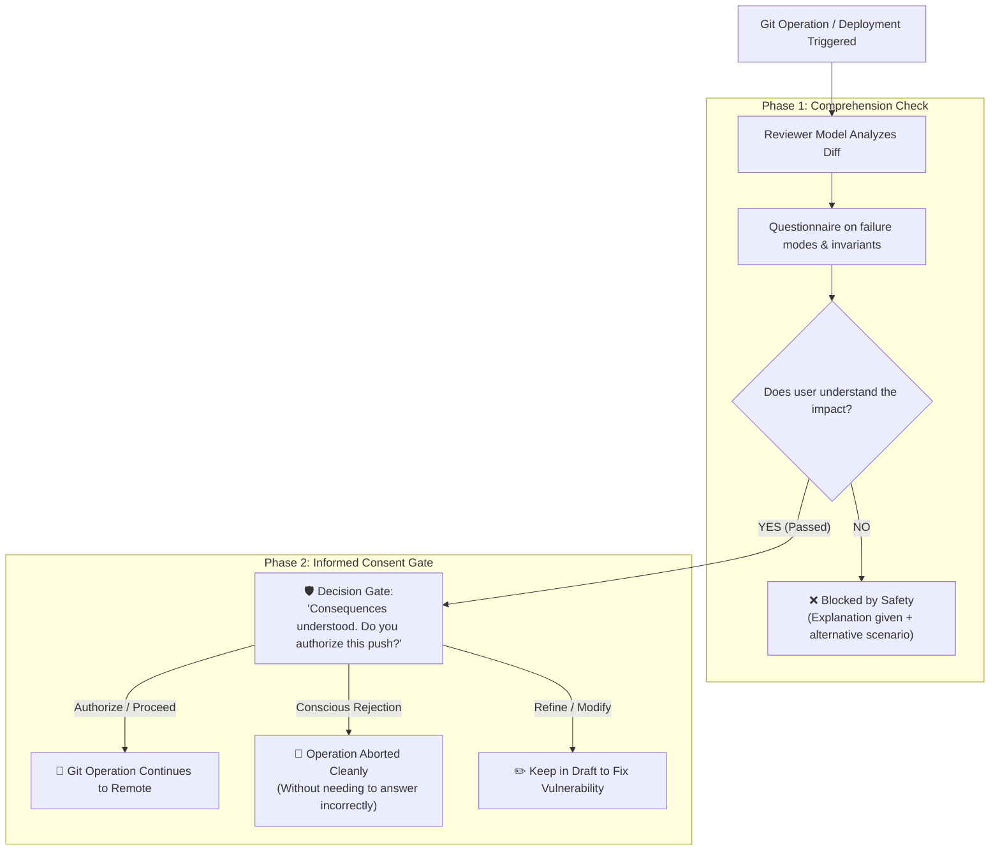

# RFC: Decoupling Comprehension from Execution (The 2-Phase Informed Consent Gate)

**Author:** Samuel Suiri (@SamuelSuiri) & Antigravity  
**Status:** Proposal / Contribution RFC  
**Target:** Sphinx (`parthh01/sphinx`)  

---

## 1. Executive Summary

Sphinx introduces a vital principle to AI-assisted coding: *"You can outsource your thinking, but not your understanding."*

However, in its current design, **answering the understanding quiz correctly is coupled directly to the immediate release/continuation of the Git operation**. 

This RFC proposes **decoupling comprehension from authorization** via a **2-Phase Gate**:
1. **Phase 1 (Comprehension Verification):** Assesses whether the developer predicts the runtime behavior, edge cases, and failure modes of the commit.
2. **Phase 2 (Informed Consent Decision):** If the developer passes Phase 1, they are explicitly asked: *"Now that the consequences and failure modes are understood, do you authorize this push to proceed, or do you want to abort/modify the change?"*

---

## 2. The Core Problem: The "Expert's Dilemma"

In the current workflow:
* If the developer answers **incorrectly**, the push is blocked (safe).
* If the developer answers **correctly**, the push proceeds automatically.

### The Paradox:
An experienced software engineer or tech lead might inspect an agent's patch and immediately realize:
> *"This change disables `proxy_buffering` on Nginx. Under a burst of slow 3G clients, this will tie up all PHP-FPM / Node workers and cause an involuntary Slowloris outage."*

If the developer explains this reasoning accurately:
* The evaluator model grades the answer as **100% correct**.
* Sphinx marks the checkpoint as `passed`.
* **Git pushes the dangerous change directly to production!**

To prevent the destructive change from landing in production, the developer had to **deliberately choose a wrong answer**, type nonsense, or kill the process terminal.

---

## 3. The 2-Phase Solution

---

## 4. Experimental Evidence & Validation

We validated this 2-phase pattern in an agentic coding environment (Gemini Antigravity) running on Debian/Windows stacks:

1. **Phase 1 Validation:**
   - Scenario: Nginx `fastcgi_cache_use_stale updating error timeout;` cache resilience.
   - Result: Developer identified that cached items return stale HTTP 200, but un-cached requests return HTTP 502 upon backend failure.
2. **Phase 2 Authorization Gate:**
   - System confirmed technical accuracy and immediately rendered the Phase 2 Decision Modal.
   - Developer exercised conscious authorization without being forced into automatic execution.

*(Complete test video recordings and logs captured during validation sessions).*

---

## 5. Proposed Changes to Sphinx Core

1. **`src/sessions.js`:**
   - Introduce `session.verdict = 'understood'` distinct from `session.status = 'passed'`.
   - Add a consent hook before setting `status = 'passed'`.
2. **`src/browser-page.js` & `src/browser-interview.js`:**
   - Render a Phase 2 confirmation banner once all concepts are understood:
     * `[Proceed with Git Push]`
     * `[Abort Git Operation (Safe Cancel)]`
3. **CLI / Terminal (`src/terminal-check.js`):**
   - Provide interactive confirmation prompt `[Y/n]` with summary of acknowledged risks before unlocking the Git hook.
